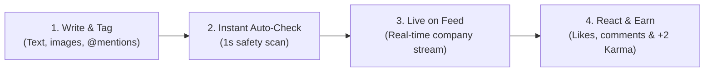
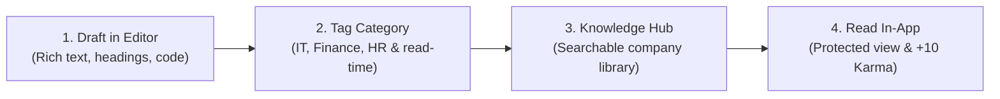
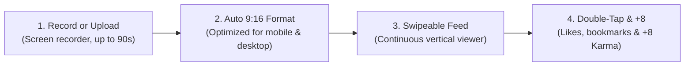
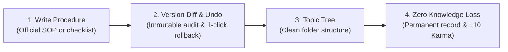
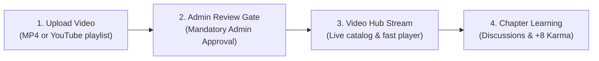
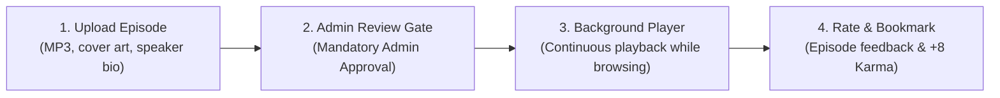

# Knome Enterprise Platform — Full Presentation Deck
**Client / Organization:** MPOnline Limited  
**Version:** 1.0 Enterprise Edition  
**Technology Stack:** ASP.NET Core 10 Web API, React 19 / Vite, Microsoft SQL Server 2022, SignalR, YARP Gateway, EmployeeHub SSO  

---

## Slide 1: Title & Executive Introduction
- **Project Title:** KNOME — Enterprise Knowledge Management & Collaborative Media Portal
- **Target Organization:** MPOnline Limited
- **Core Architecture:** Monorepo (`Backend/Knome.API` + `Frontend/knome-web`)
- **Key Identity Integration:** Seamless Single Sign-On (SSO) with EmployeeHub Identity Provider

---

## Slide 2: Executive Vision — 4 Industry Models in 1 Ecosystem
1. **LinkedIn Model:** Professional employee profiles, departmental networking, connection requests, and real-time social timeline feed.
2. **Medium Model:** Long-form technical articles, structured documentation, rich text authoring, revision history, and protected attachments.
3. **YouTube Model:** Technical video streaming, YouTube playlist sync, video modules, and episode-based audio podcasts.
4. **StackOverflow Model:** Gamified Karma engine, contribution tiers (Bronze to Platinum), real-time leaderboards, and autonomous point awards.

---

## Slide 3: Role-Based Access Control (RBAC) — Capability Model
*FRD capability boundaries — ✓ permitted | — not assigned in the FRD*

| Capability | EMP | CADM | HRADM | SYSADM |
| :--- | :---: | :---: | :---: | :---: |
| **Create / edit personal profile** | ✓ | ✓ | ✓ | ✓ |
| **Create text / image / video posts** | ✓ | ✓ | ✓ | ✓ |
| **Publish articles / blogs** | ✓ | ✓ | ✓ | ✓ |
| **Upload video / podcast** | ✓ | ✓ | ✓ | ✓ |
| **Create community** | ✓ | — | ✓ | ✓ |
| **Approve community join requests** | — | ✓ | ✓ | ✓ |
| **Moderate community content** | — | ✓ | ✓ | ✓ |
| **Manage banners / announcements** | — | — | ✓ | ✓ |
| **Post internal job vacancies** | — | — | ✓ | ✓ |
| **View analytics dashboard** | — | ✓ | ✓ | ✓ |
| **Manage user access & roles** | — | — | — | ✓ |
| **Configure system settings** | — | — | — | ✓ |
| **Earn / view Karma Points** | ✓ | ✓ | ✓ | ✓ |

> **Key principle:** Authorization is role-scoped; SYSADM owns access/configuration, while CADM governs community-level operations and HRADM governs HR/platform functions.

---

## Slide 4: EmployeeHub Single Sign-On (SSO) & Dual-Issuer JWT Trust
### The Authentication Mechanism:
```
[EmployeeHub Login (:5001)] 
         │ (User enters EmpId & Password -> Validates against Identity DB)
         ▼
[Issues HMAC-SHA256 Signed JWT Token] (Claims: sub, employeeId, fullName, role)
         │
         ▼
[Redirects to Knome with Query Params]
  URL: http://localhost:5173/?sso_token=<JWT>&employeeId=MPO103
         │
         ▼
[Knome Frontend UserContext.jsx]
  • Intercepts sso_token & employeeId from URL
  • Saves securely into localStorage (knome_jwt, knome_employeeId)
  • Sanitizes URL query params using window.history.replaceState
  • Initiates backend verification GET /api/users/profile
         │
         ▼
[Knome ASP.NET Core API Backend (:5095)]
  • Dual-Issuer JWT Bearer middleware validates token signature
  • ValidIssuers: ["Knome.API", "EmployeeHub.Identity"]
  • ValidAudiences: ["Knome.Client", "EmployeeHub.Client"]
  • No external network round-trip needed -> Instant zero-click authentication!
```

---

## Slide 5: Full-Stack Technical Architecture
- **Backend Framework:** ASP.NET Core 10 (C#), Clean Controller-Service-Repository architecture.
- **Frontend Framework:** React 19, Vite HMR, TypeScript/JSX, Vanilla CSS + Tailwind utility tokens.
- **Database:** Microsoft SQL Server 2022 (Normalized relational schema with live EF Core 10 scaffolding).
- **Real-Time Layer:** SignalR WebSocket Hub (`/hubs/notifications`) for instant push alerts.
- **Security:** BCrypt Work Factor 11 password hashing, protected in-app document viewing, role-based access control (RBAC).

---

## Slide 6: Knowledge Articles & Enterprise Documentation
- **Rich Editor:** Multi-format publishing with code blocks, tables, and callouts.
- **Revision History:** Full audit trail of article versions with author attribution.
- **Category Tagging:** Cross-departmental discovery with keyword search.
- **Sandboxed Attachments:** PDF manuals and SOPs open in-app without leaking download links.

---

## Slide 7: Media Studio — Videos & Technical Podcasts
- **Video Modules:** Self-hosted video streaming & YouTube Playlist synchronization with automatic metadata extraction.
- **Podcast Channels:** Audio series with continuous background player, speaker tagging, and transcript viewing.
- **Interactive Engagement:** Video timestamp discussions, like/dislike counts, and saved bookmarks.

---

## Slide 8: How It Works: Posts, Articles, Wiki, Videos, Podcasts & Clips
*(Simple step-by-step lifecycle flows with visual diagrams so anyone can easily understand)*

### Quick Comparison Matrix
| Format | What Is It Used For? | Who Can Create? | Approval Needed? | Karma Points |
| :--- | :--- | :--- | :--- | :--- |
| **📰 Posts** | Quick updates, milestones & team news | Any Employee | ⚡ Instant Pass (Auto-filtered) | **+2 Karma** |
| **📄 Articles** | Detailed guides, SOPs & manuals | Any Employee | ⚡ Instant Pass to Knowledge Hub | **+10 Karma** |
| **🎬 Clips** | 90s vertical video reels & screen tips | Any Employee | ⚡ Instant Pass to Reels Feed | **+8 Karma** |
| **📖 Wiki** | Company handbook, policies & audit trails | Any Employee | ⚡ Instant Pass (Full Version History) | **+10 Karma** |
| **📹 Videos** | Full training courses & tutorials | Leads / Approved Staff | 🛡️ **Admin Clearance Required** | **+8 Karma** |
| **🎙️ Podcasts** | Leadership talks & audio series | Voice Leads / Leaders | 🛡️ **Admin Clearance Required** | **+8 Karma** |

---

### Step-by-Step Flow Diagrams for Each Format:

#### 1. 📰 Posts: Quick Updates & Team Announcements
*Fast, informal updates to celebrate wins, ask questions, or broadcast team news across the company.*

- **Real Workplace Example:** A project lead posts: *"Great job team! MPOnline Portal Phase 1 migration completed ahead of schedule 🚀"* — teammates reply with congratulations and claps.

---

#### 2. 📄 Articles: In-Depth Guides, Best Practices & Manuals
*Long-form structured guides with headings, diagrams, bullet points, and attached documents.*

- **Real Workplace Example:** An IT senior writes: *"Complete Guide: Connecting to MPOnline VPN from Home on Windows & Mac"* — new joiners find it in seconds instead of calling the helpdesk.

---

#### 3. 🎬 Clips: Quick 90-Second Vertical How-To Videos
*Bite-sized vertical video reels for screen recordings, feature spotlights, and quick productivity tips.*

- **Real Workplace Example:** A finance team member records a 45-second screen capture: *"How to download approved invoice vouchers in 3 clicks"* — saves colleagues 20 minutes every day.

---

#### 4. 📖 Wiki: Company Handbook, Policies & Official SOPs
*The single source of truth for standard procedures, with complete version tracking and 1-click restore.*

- **Real Workplace Example:** Operations publishes the *"Hardware Replacement & Laptop Request SOP"*. When policy updates 6 months later, previous versions remain readable for audit.

---

#### 5. 📹 Videos: Official Training Courses & Masterclasses
*Horizontal multi-minute training courses with admin quality control and chapter timestamps.*

- **Real Workplace Example:** Cybersecurity team uploads a 25-minute *"Data Privacy & Phishing Defense 2026"* course. System Admin approves it, making it mandatory training for 1,200 staff.

---

#### 6. 🎙️ Podcasts: Audio Broadcasts & Leadership Talks
*Audio episodes employees can listen to in the background while multitasking or during their commute.*

- **Real Workplace Example:** Managing Director records *"Monthly Leadership Address: 2026 Goals & Tech Roadmap"*. Staff listen with headphones while completing their morning tasks.

---

## Slide 9: Communities & Governance Lifecycle
1. **Creation:** Standard employees submit community requests with custom rules, banner, and FAQs.
2. **Review Queue:** Request is marked as `Pending Approval` and immediately dispatches a real-time notification to HR & System Admins.
3. **Approval Dashboard:** Admins review pending communities on `/communities?tab=Approvals`.
4. **Activation:** On approval, the community is published live, creator is assigned as `Community Admin`, and celebration alerts are broadcast.

---

## Slide 10: Gamification & Karma Engine
- **Autonomous SQL Server Ledger:** Points awarded automatically via `dbo.KarmaTransactions` for verified engagement.
  - `+10 Pts`: Publishing an Article or Wiki
  - `+8 Pts`: Uploading Video, Podcast or Clip
  - `+2 Pts`: Creating Feed Updates / Posts
  - `+1 to +3 Pts`: Receiving Reactions, Comments & Shares
- **Tier Progression:**
  - **Bronze (Newbie):** 0 – 250 Pts
  - **Silver (Contributor):** 251 – 1,000 Pts
  - **Gold (Expert):** 1,001 – 5,000 Pts
  - **Platinum (Legend):** 5,000+ Pts
- **Live Leaderboard:** Real-time ranking of MPOnline's top contributors.

---

## Slide 11: Standardized Sharing & Document Protection
- **Unified 2-Option Share Modal:**
  1. `Share to Community` (Post content directly into specialized community feed)
  2. `Share with Users` (Send targeted peer-to-peer notification to specific colleagues)
- **Data Protection:**
  - Zero raw download links (`target="_blank"` removed).
  - Print toolbars and PDF download ribbons suppressed (`#toolbar=0`).
  - Right-click context menus and text scraping disabled on preview modals.

---

## Slide 12: SignalR Real-Time Notifications
- **WebSockets Engine:** Instant push delivery for comments, mentions, invites, and badge promotions.
- **Strict Chronological Priority:** Latest incoming notifications are pinned at Index 0 (top of list) with "Just now" timestamps.
- **Real-Time Role Unlock:** When an Admin assigns a role, the employee's pending modal clears instantly without browser refresh.

---

## Slide 13: Analytics & Workforce Intelligence
- **100% Live SQL Server Database Metrics:**
  - `RPT-01 (User Engagement)`: Registered workforce, active users, suspension status, and karma breakdown.
  - `RPT-02 (Community Health)`: Member counts, active communities, and post frequency.
  - `RPT-03 (Content Performance)`: Aggregated counts across posts, articles, videos, podcasts, and reactions.
  - `RPT-04 (Trending Contributors)`: Top departmental champions from live karma transactions.
  - `RPT-05 (Security & Moderation)`: Security audit logs, reported content flags, and resolution status.
- **Export Options:** Corporate reports exportable to **CSV** and **Excel (.xls)**.

---

## Slide 14: 4-Tier Role Governance Architecture
- **Employee (`EMP`):** Content creation, learning tracks, community participation, and karma progression.
- **Community Admin (`CADM`):** Community space moderation, join request review, and group settings.
- **HR Administrator (`HRADM`):** Company-wide broadcasts, community approvals, user role management, and platform analytics.
- **System Administrator (`SYSADM`):** Full platform governance, immutable security audit logs, and account lifecycle.

---

## Slide 15: Strategic Business Impact for MPOnline
- **40%+ Faster Onboarding:** Consolidated video tutorials and SOPs accelerate knowledge ramp-up for new recruits.
- **Zero Knowledge Loss:** Critical solutions and architecture blueprints preserved in institutional memory.
- **Government Compliance:** On-premise SQL Server deployment, in-app document protection, and immutable audit logs.

---

## Slide 16: Conclusion & Live Demonstration
- **Live System URLs:**
  - **EmployeeHub SSO:** `http://localhost:5001`
  - **Knome Web Portal:** `http://localhost:5173`
  - **Backend Swagger API Docs:** `http://localhost:5095/swagger`
- **Ready for Production Deployment & Executive Review.**
